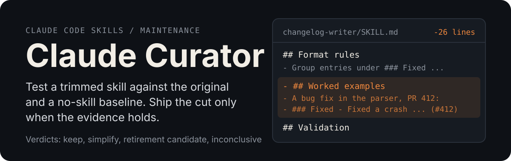
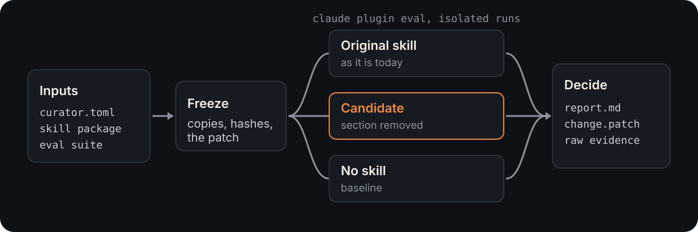
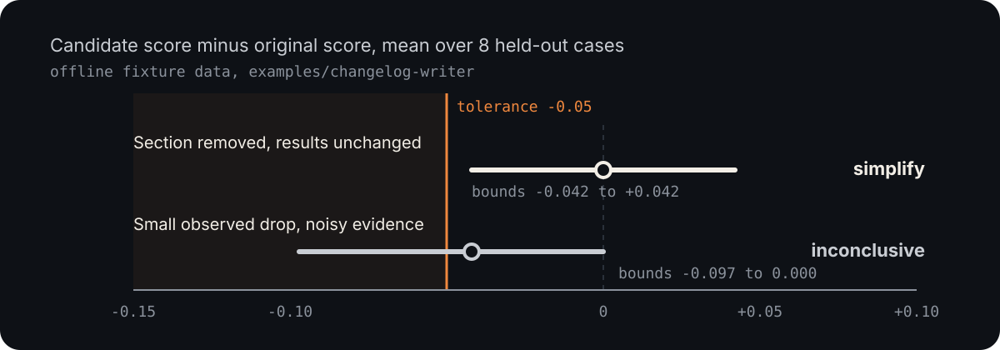

<p align="center">
  
</p>

<p align="center"><strong>A maintenance tool for Claude Code skills: measure each skill's impact on task outcomes and identify instructions that are no longer needed.</strong></p>

<p align="center">
  <a href="#getting-started">Getting started</a> ·
  <a href="#how-it-decides">How it decides</a> ·
  <a href="#usage">Usage</a> ·
  <a href="#running-the-tests">Tests</a>
</p>

## What you get

One command runs the experiment and prints a verdict, a report, a patch and the
evidence behind it. This is the bundled offline example, which replays scripted
outcomes and makes no model calls:

```text
$ python3 -m claude_curator run examples/changelog-writer/curator.toml \
    --runner fixture --fixture examples/changelog-writer/fixtures/preserves.json

OFFLINE FIXTURE: scripted outcomes, no model calls. This exercises the workflow, not live behaviour.

Recommendation: simplify
  - the candidate's lower bound stays within tolerance 0.05 (candidate - original: +0.000
    (one-sided 95% bounds -0.042 / +0.042, 8 cases)) and all critical requirements were preserved

Report:   .claude-curator/runs/<run-id>/report.md
Patch:    .claude-curator/runs/<run-id>/change.patch
Evidence: .claude-curator/runs/<run-id>
```

And this is a live run through `claude plugin eval`: one case, one run per
condition, Claude Sonnet 5.5, in an isolated Debian 12 VM. It is an integration
check, not a verdict; the decision rules need at least two cases.

| Condition | Turns | Estimated cost | Skill invoked | Graders |
|---|---|---|---|---|
| Original skill | 6 | $0.054 | observed | heading, entry, validator run: all pass |
| Simplified (Worked examples removed) | 7 | $0.055 | observed | heading, entry, validator run: all pass |
| No skill | 5 | $0.050 | not applicable | heading and entry pass; validator not run |

## About

Skills collect instructions that newer models may no longer need, and maintainers
rarely know which ones are safe to cut. Claude Curator answers one narrow question:

> Does this skill still need these instructions, or can they be cut without making
> it less useful or breaking its requirements in this project?

You give it a skill package, the section to remove (or your own edited copy), an
existing eval suite, and the requirements the skill must keep meeting. It runs the
same held-out cases against the original skill, the simplified skill and no skill,
applies explicit decision rules, and writes a Git patch with the evidence behind
it. The answer is `keep`, `simplify`, `retirement-candidate` or `inconclusive`.
Broken or outdated instructions are reported separately as update findings.

It is a small local command-line tool. It never edits your installed skills or
global settings: every experiment works on frozen copies.

Claude Curator is an independent community project. It is not affiliated with or
endorsed by Anthropic.

## How it works

<p align="center">
  
</p>

- **Runner:** Claude Code's own `claude plugin eval`. Each run gets a temporary
  home directory and configuration with only the skill under test loaded, and the
  graders are hidden from the agent.
- **Fair comparison:** the eval suite is frozen and hash-checked before and after
  every invocation, so grading cannot drift between conditions. Conditions run
  interleaved per case, in alternating order.
- **Failures are classified, not scored:** a run that hit a rate limit, failed to
  start or lost a grader is excluded and reported, so infrastructure problems never
  look like a skill regression.

## How it decides

<p align="center">
  
</p>

An equal score is not enough to remove a section. Claude Curator compares the
uncertainty range, not just the average, against a tolerance you set. Repeated
runs of one case are averaged first, so they never count as extra task coverage,
and the range comes from resampling cases and runs with a fixed, recorded seed.

The rules, in order:

1. Integrity problems or too few cases and runs: `inconclusive`.
2. The original skill was not observed invoked often enough: `inconclusive`, with
   a routing diagnosis. A skill that never activates has not had its instructions
   tested.
3. A critical requirement violated by the candidate: `keep`, whatever the score or cost.
4. A critical requirement the original itself does not reliably meet:
   `inconclusive`, plus an update finding.
5. No skill at all stays within tolerance of the original, and every critical
   requirement holds without it: `retirement-candidate`, a nomination for review.
6. The lower bound of the effect is at or above `-tolerance`: `simplify`.
7. The upper bound is below `-tolerance`: `keep`.
8. Otherwise: `inconclusive`.

Cost and duration are reported but never enter the rules. The rationale is in
[ADR 0001](docs/decisions/0001-architecture.md).

## Getting Started

### Prerequisites

- Python 3.11 or newer. Claude Curator uses only the standard library.
- Git, to apply the patch it produces.
- For real runs only: Claude Code 2.1.269 or newer, signed in the way your normal
  sessions are. Real runs call the model and use your plan or API budget.

### Installing

```bash
python3 -m pip install .
```

Or run it from a checkout without installing:

```bash
PYTHONPATH=src python3 -m claude_curator --help
```

### Try it offline

```bash
PYTHONPATH=src python3 -m claude_curator run examples/changelog-writer/curator.toml --runner fixture --fixture examples/changelog-writer/fixtures/preserves.json
```

Six more scripted scenarios in `examples/changelog-writer/fixtures/` show the other
verdicts: a removal that breaks a requirement (`keep`), a skill that never
activates, noisy evidence, a runner failure, a budget stop and a candidate that
references a missing file (all `inconclusive`). None of them call a model.

## Usage

### 1. Describe the experiment

An experiment is one `curator.toml` beside your skill and eval suite:

```toml
[skill]
path = "skills/changelog-writer"        # SKILL.md plus scripts/, references/, ...
repo_path = "skills/changelog-writer"   # where it lives in your repository, for the patch

[change]
remove_section = "Worked examples"      # or: candidate = "path/to/your/edited/copy"
rationale = "The examples restate the format rules."

[suite]
path = "evals"                          # cases in the `claude plugin eval` layout
development = ["dev-rename-command"]    # cases you used while preparing the change
heldout = ["fix-parser-crash", "add-export-flag", "..."]   # cases that judge it
explicit = ["explicit-request"]         # prompts that name the skill outright
no_invocation_expected = ["read-current-version"]          # negative controls

[decision]
tolerance = 0.05      # largest acceptable drop in mean case score (0..1)
confidence = 0.95
min_cases = 6
min_runs_per_case = 3

[[requirements]]
id = "validator"
description = "The bundled validator is run before finishing"
critical = true
graders = ["fix-parser-crash/ran-validator"]            # case/grader pairs from the suite
package_contains = [{ file = "SKILL.md", text = "scripts/check_changelog.py" }]

[run]
runs = 3
model = "claude-sonnet-5-5"            # pin it; required for real runs
judge_model = "claude-haiku-5-5"
allow_tools = ["Write", "Edit", "Bash(python3 *)"]
scaffold = true                          # run each case's scaffold_script (only for suites you wrote)
max_runs = 90
max_cost_usd = 15.0
```

The suite uses the official
[`claude plugin eval` case layout](https://code.claude.com/docs/en/plugin-evals#eval-suite-reference)
(`<case>/prompt.md`, optional `case.yaml`, `graders/*.md`). Unknown keys in
`curator.toml` are errors, so a typo cannot silently change an experiment.

### 2. Check it for free

```bash
claude-curator check path/to/curator.toml
```

Scans both packages for missing or out-of-package references and unsupported
features, shows the patch size, the planned number of agent runs and the exact
runner command, and keeps nothing. It exits 1 if the candidate introduces a problem.

### 3. Run it

```bash
claude-curator run path/to/curator.toml --trust-plugin --max-runs 90 --max-cost-usd 15
```

A real run refuses to start without a run limit, a spending ceiling and a pinned
model. `--trust-plugin` is required because `claude plugin eval` cannot ask for
trust when it runs non-interactively; passing it asserts you trust the skill and
the suite.
The spending ceiling is checked before each run starts, so a run already in
progress can finish past it. Costs are Claude Code's list-price estimates, not
invoices or plan usage.

### 4. Read and act on the result

```bash
claude-curator report path/to/.claude-curator/runs/<run-id>
git apply path/to/.claude-curator/runs/<run-id>/change.patch
git apply -R path/to/.claude-curator/runs/<run-id>/change.patch
```

`report` recomputes the verdict from the stored evidence without running anything.
Apply the patch from your repository root; `-R` reverses it. Each run directory
also keeps frozen copies of the original, the candidate and the suite, plus every
runner's raw output, so an accepted change can be reversed and reassessed later.
Missing cost, duration or token data is reported as unavailable, never as zero.

## Running the tests

```bash
PYTHONPATH=src python3 -m unittest discover -s tests -t .
```

70 tests cover section removal and dependency scanning, patch generation (applied
and reversed with `git apply`), spec validation, failure classification, every
decision rule, the seven scenarios above, and the runner adapter against a stub
`claude` executable. None of them call a model. They pass on macOS and Linux.

## Authors

- [@savsuth](https://github.com/savsuth)

## Acknowledgements

Studied while designing this tool (all MIT licensed; no code copied):

- [tardigrde/agent-skill-eval](https://github.com/tardigrde/agent-skill-eval): eval-suite shape and failure handling
- [takehiro177/skill-evaluator](https://github.com/takehiro177/skill-evaluator): A/B framing and cost-weighting caveats
- [ruc-datalab/SkillAdam](https://github.com/ruc-datalab/SkillAdam): automated skill optimisation, deliberately out of scope here
- [affaan-m/ECC skill-stocktake](https://github.com/affaan-m/ECC/tree/main/skills/skill-stocktake) and [mblode/agent-skills capability-delta](https://github.com/mblode/agent-skills/blob/main/skills/agent-skills-creator/references/capability-delta.md): keep, cut and retire vocabulary

## License

MIT. See [LICENSE](LICENSE).
